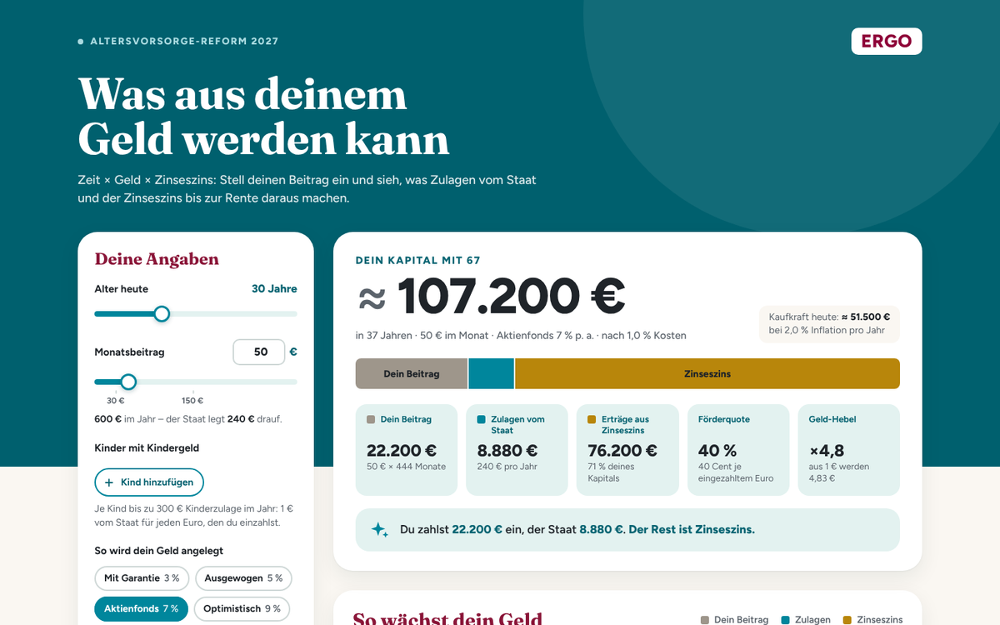

# Altersvorsorge-Rechner „Zeit × Geld × Zinseszins“

Interaktiver Rechner für die Beratung zur **Altersvorsorge-Reform 2027**. Er zeigt, was aus einem Monatsbeitrag mit den Zulagen vom Staat und dem Zinseszins bis zur Rente werden kann. Optik wie die Story-Slides: türkiser Kopf, Fraunces und Figtree, Farben der Zinseszins-Slide.

**Online:** https://vorsorge-rechner-siebenburgen.github.io/av-rechner/

## Was der Rechner zeigt

| Bereich | Inhalt |
|---|---|
| **Kapital mit 67** | große Zahl mit Balken *Dein Beitrag · Zulagen · Zinseszins*, dazu die Kaufkraft in heutigem Geld |
| **Kennzahlen** | eingezahlt, Zulagen vom Staat, Erträge aus Zinseszins, Förderquote (Cent je eingezahltem Euro), Geld-Hebel (aus 1 € werden …) |
| **So wächst dein Geld** | gestapelte Fläche über das Alter mit **Kipppunkt** („Ab 48 arbeitet dein Geld mehr als du“) und dem Anteil, der erst in den letzten 10 Jahren entsteht; Tabelle zum Aufklappen |
| **Warten kostet** | Start heute vs. in 5 und 10 Jahren, dazu: „Für dasselbe Ergebnis bräuchtest du dann X € statt Y € im Monat.“ |
| **Anlage-Profile** | Garantie 3 %, Ausgewogen 5 %, Aktienfonds 7 %, Optimistisch 9 % im Vergleich. Antippen der Legende wechselt das Profil. |
| **Kleiner Beitrag, großer Zuschuss** | Förderquote je Monatsbeitrag mit und ohne Kinder |
| **Kontakt** | „Schreib mir einfach RENTE“ (WhatsApp), Anruf, ERGO-Förderrechner |

Eingaben: Alter, Monatsbeitrag (10–300 € per Regler, bis 1.000 € im Zahlenfeld), Kinder mit Alter, Anlage-Profil oder eigene Rendite. Unter „Weitere Annahmen“ stehen Rentenbeginn, Kosten, Inflation und die Kinderzulage bis 25.

## Im Kundentermin

- **Präsentieren** (Knopf unten oder Taste **P**): Vollbild, größere Schrift. Mit **Esc** oder **P** beendest du die Präsentation.
- Alle Regler lassen sich auch mit den Pfeiltasten bedienen.
- Beim Herunterscrollen bleibt unten eine Leiste mit dem Kapital stehen.

## Verschicken

- **Per WhatsApp senden**: Öffnet WhatsApp mit dem Text „Hallo Anna, hier ist deine persönliche Modellrechnung …“ und dem Link. Den Empfänger wählst du in WhatsApp.
- **Link kopieren**: Der Link enthält alle Einstellungen, z. B.
  `…/av-rechner/?alter=30&beitrag=50&profil=aktien&kosten=1&rente=67&kinder=3,6&fuer=Anna`
  Wer ihn öffnet, sieht genau diese Rechnung.
- **PDF speichern**: 2 Seiten A4 mit Name, Datum, Kennzahlen, Diagramm, Tabelle, „Warten kostet“, Kontakt und Hinweisen. Die Links im PDF sind antippbar. Auf dem Handy: Teilen → Drucken → Als PDF sichern.
- **Persönlich für**: Der Name steht dann oben auf der Seite, im PDF und im Link.

## So wird gerechnet

Wie auf der Zinseszins-Slide der Story, damit alle Zahlen zusammenpassen:

- Der Beitrag wird jeweils am Monatsende eingezahlt und mit dem gleichwertigen Monatszins `(1 + r)^(1/12) − 1` verzinst.
- Die Zulagen kommen jeweils am Jahresende dazu, der Startbonus einmal am Ende des ersten Jahres.
- Kosten mindern die Rendite: Netto = `(1 + Rendite) × (1 − Kosten) − 1`.
- Grundzulage: 50 % auf die ersten 360 € Eigenbeitrag, 25 % auf den Teil bis 1.800 €, höchstens 540 € im Jahr.
- Kinderzulage: 1 € je eingezahltem Euro, höchstens 300 € je Kind und Jahr. Sie läuft bis zum 18. Geburtstag des Kindes, auf Wunsch bis zum 25.
- Mindestbeitrag 120 € im Jahr, Startbonus 200 € bei Beginn vor dem 25. Geburtstag
- „Warten kostet“: gleicher Beitrag und gleicher Rentenbeginn. Die Kinder sind dann älter, der Startbonus fällt ggf. weg. Der nötige Beitrag wird per Bisektion gesucht.
- Kaufkraft: Kapital ÷ (1 + Inflation)^Jahre
- Das ist eine Modellrechnung vor Steuern mit gleichbleibender Wertentwicklung, ohne Garantie. Der Steuervorteil (Sonderausgabenabzug) wird nicht gerechnet. Die Fußnote auf der Seite sagt das.

Kontrolle: 50 € im Monat, 40 Jahre, 6 % ohne Kosten ergeben **132.527 €**, bei 9 % sind es **292.054 €**. Das sind dieselben Werte wie auf der Slide. Die Tests prüfen das.

## Anpassen

Alles Wichtige steht oben in `index.html` im Block `window.RECHNER`:

| Eintrag | Bedeutung |
|---|---|
| `PROFIL` | Name, Rolle, Telefon, WhatsApp-Nummer, Stichwort (RENTE), Foto |
| `LINK` | persönlicher ERGO-Link |
| `OEFFENTLICHE_URL` | Adresse des Rechners, für Links, wenn die Seite lokal geöffnet ist |
| `ERGO_LOGO` | leer = Schriftzug, sonst z. B. `'assets/ergo-logo.svg'` |
| `ANLAGE_PROFILE` | Name, Rendite und Erklärtext der Profile |
| `STANDARD` | Startwerte: Alter, Rentenbeginn, Beitrag, Profil, Kosten, Inflation |
| `FOERDERUNG` | Abweichungen von den Fördersätzen in `rechnung.js` |

Farben und Schriftgrößen stehen in `rechner.css` (oben), die Rechnung steht in `rechnung.js`.

Bitte prüf, ob ERGO für Renditebeispiele in der Werbung feste Sätze vorgibt. Ist das so, trägst du sie bei `ANLAGE_PROFILE` ein.

## Technik

- statische Seite ohne Build-Schritt
- alles liegt lokal: Schriften, [Chart.js 4.5.1](https://www.chartjs.org) (MIT) in `vendor/`
- `rechnung.js`: reine Rechenfunktionen, laufen im Browser und in Node
- `app.js`: Oberfläche, Diagramme, Link, PDF, Präsentation
- Tests: `npm test` (Node 20 oder neuer)
- Lokal ansehen: `python3 -m http.server` in diesem Ordner, dann http://localhost:8000 öffnen

## Veröffentlichen und aktualisieren

Der Rechner wird im privaten Repo **AV-NEU** im Ordner `rechner/` gepflegt. Der Inhalt dieses Ordners liegt außerdem im öffentlichen Repo [**vorsorge-rechner-siebenburgen/av-rechner**](https://github.com/vorsorge-rechner-siebenburgen/av-rechner) auf `main`, und GitHub Pages liefert ihn von dort aus.

- **Einmalig:** av-rechner → Settings → Pages → „Deploy from a branch“ → Branch `main`, Ordner `/ (root)` → Save
- **Nach Änderungen:** den Inhalt von `rechner/` wieder nach av-rechner `main` übertragen. Nach etwa einer Minute ist die neue Version online.

## Quellen (Stand 10/2026)

- Altersvorsorgereformgesetz: Bundestag 27.03.2026, Bundesrat 08.05.2026, BGBl. I Nr. 156, gilt ab 01.01.2027
- [Bundesrat-Drucksache 206/26](https://dserver.bundestag.de/brd/2026/0206-26.pdf)
- [KPMG: Gesetz im BGBl. veröffentlicht](https://klardenker.kpmg.de/financialservices-hub/regulatory-update/altersvorsorgereformgesetz-im-bgbl-veroeffentlicht/)

Schriften: Fraunces und Figtree (SIL Open Font License 1.1). Diagramme: Chart.js (MIT).
